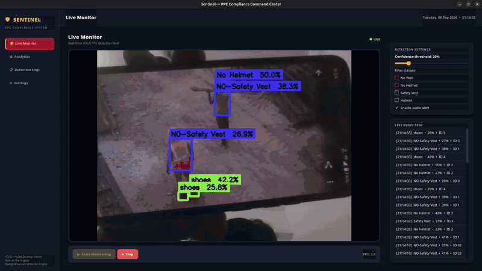
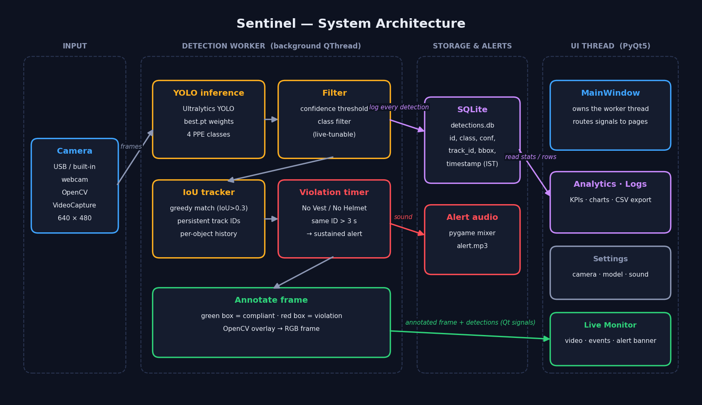
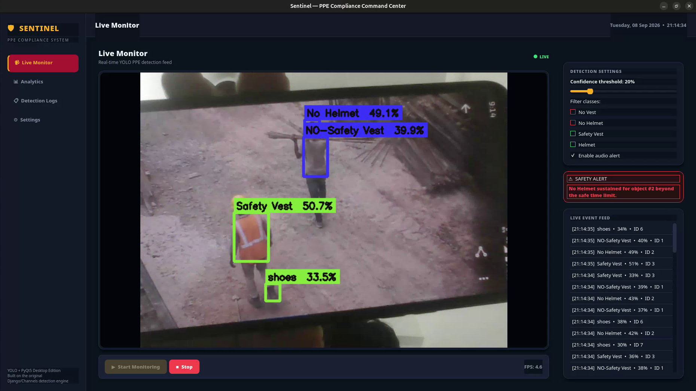
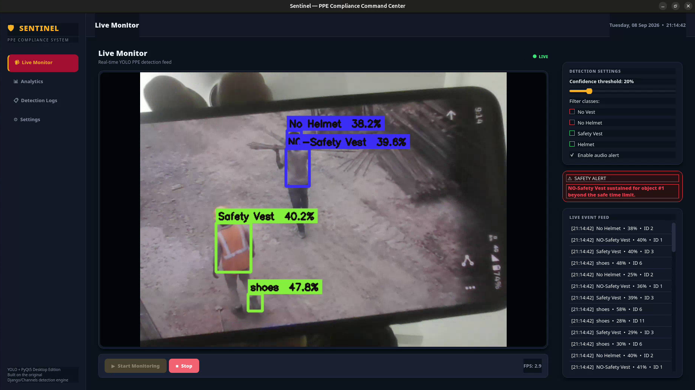
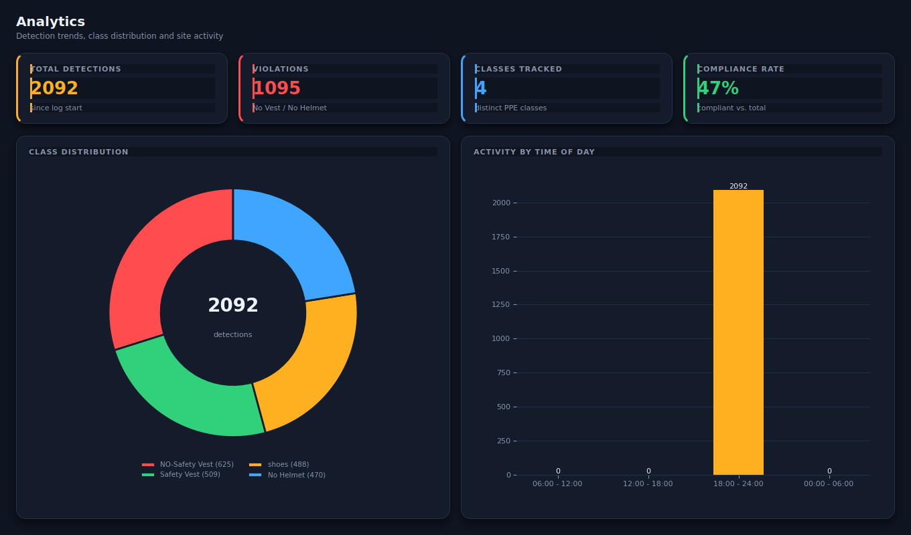
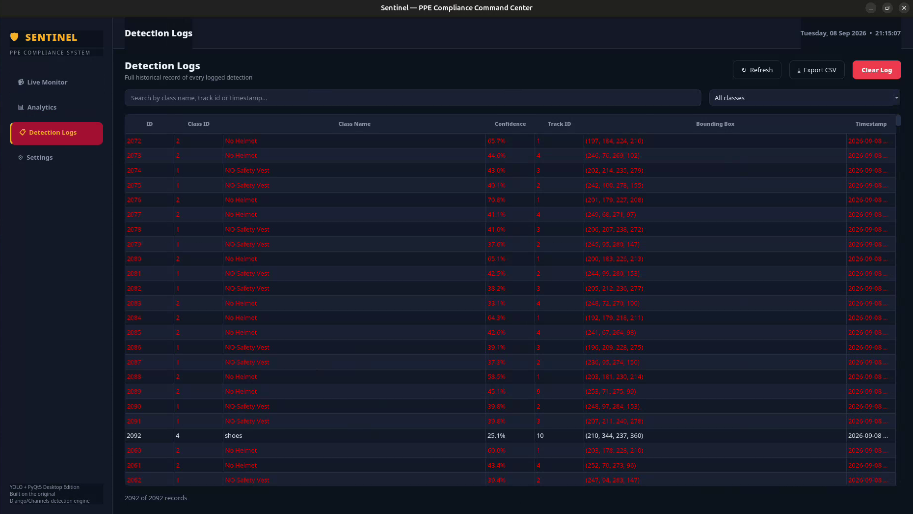
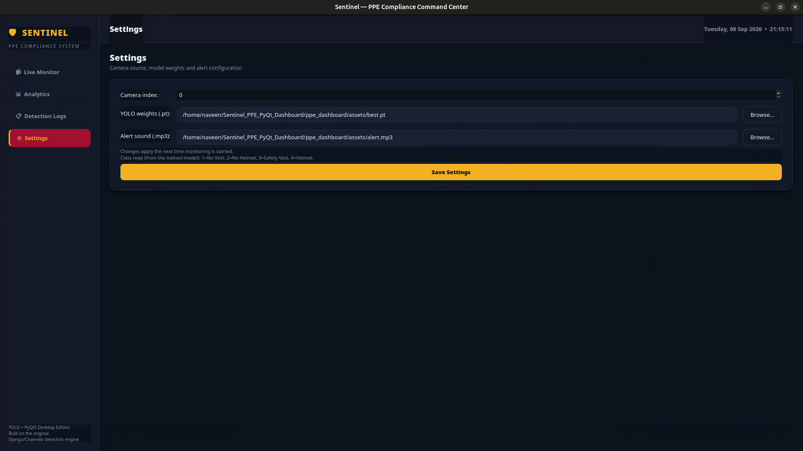

# 🛡️ Sentinel — Real-Time PPE Compliance Command Center

> A native desktop application that watches a live camera feed, detects whether workers are wearing
> required safety gear (**safety vest, helmet**) using a YOLO model, and raises a sound + on-screen alert
> when a violation persists — while logging every detection for analytics and audit.



▶️ **Full demo video (55 s):** [`demo/demo.mp4`](demo/demo.mp4) · [`demo/demo.webm`](demo/demo.webm)
&nbsp;|&nbsp; 🏗️ [Architecture](#architecture) · 📸 [Screenshots](#screenshots) · 🚀 [Run it](#getting-started)

---

## Table of contents
1. [Problem statement](#problem-statement)
2. [Target users](#target-users)
3. [Technical approach](#technical-approach)
4. [Architecture](#architecture)
5. [Technologies & components](#technologies--components)
6. [Features](#features)
7. [Screenshots](#screenshots)
8. [Getting started](#getting-started)
9. [Testing without a camera or a worksite](#testing-without-a-camera-or-a-worksite)
10. [Project structure](#project-structure)
11. [Model classes](#model-classes)
12. [Real-world impact](#real-world-impact)
13. [Limitations & future work](#limitations--future-work)
14. [Credits](#credits)

---

## Problem statement

On construction sites, factories and warehouses, personal protective equipment (PPE) such as helmets and
high-visibility vests prevents serious injuries — but compliance is usually enforced by **supervisors
walking the floor**. That approach doesn't scale: a supervisor can't watch every worker, every camera and
every shift, violations are noticed late (or never), and there is **no objective record** of how often
they happen.

**Sentinel** automates the watching. It turns an ordinary camera into a continuous PPE monitor that flags
violations as they happen and keeps a searchable log so safety teams can see patterns instead of anecdotes.

## Target users

| User | What they get |
|---|---|
| **Site / EHS safety officers** | Real-time alerts and a log of every detection to support toolbox talks and audits |
| **Site supervisors & foremen** | An at-a-glance live view of who is missing a vest or helmet |
| **Facility & operations managers** | Compliance-rate and activity-by-time-of-day analytics to spot risky shifts |
| **Students / researchers** | A clean, readable reference for a YOLO + tracking + desktop-UI pipeline |

## Technical approach

Sentinel keeps the camera/AI work **off the UI thread** so the interface never freezes:

1. **Capture** — OpenCV reads frames from the selected camera (640×480).
2. **Detect** — each frame goes through a custom-trained **YOLO** model (`assets/best.pt`) that recognises
   four PPE classes (see [Model classes](#model-classes)).
3. **Filter** — detections below the confidence threshold or in de-selected classes are dropped. Both are
   adjustable **live** from the UI.
4. **Track** — a greedy **IoU tracker** (IoU > 0.3) gives each object a persistent track ID across frames.
5. **Decide** — if a *violation* class (No Vest / No Helmet) stays on the **same track ID for more than
   3 seconds**, it is treated as a *sustained violation*: an alert banner is shown and `alert.mp3` plays.
   Requiring persistence avoids alarming on one-frame flickers.
6. **Log** — every detection is written to **SQLite** (`class, confidence, track_id, bbox, timestamp`),
   guarded by a mutex because the detection thread writes while the UI thread reads.
7. **Present** — the annotated frame (green = compliant, red = violation) and the detections are sent to
   the PyQt5 UI through Qt signals; the Analytics and Logs pages read the database on a timer.

## Architecture



## Technologies & components

| Layer | Technology | Role |
|---|---|---|
| Object detection | **Ultralytics YOLO** + **PyTorch** | Detects vest / no-vest / no-helmet / shoes |
| Video I/O & drawing | **OpenCV** | Camera capture, bounding boxes, labels |
| Tracking & alert rule | Pure Python (IoU tracker) | Persistent IDs + 3-second sustained-violation rule |
| Desktop UI | **PyQt5** (+ custom QSS dark theme) | Live monitor, analytics, logs, settings |
| Charts | **Matplotlib** (embedded in Qt) | Class-distribution donut, time-of-day bars |
| Persistence | **SQLite** (`sqlite3`) | Detection log + statistics |
| Audio alert | **pygame** mixer | Plays `alert.mp3` on sustained violations |
| Timestamps | **pytz** | Logs in `Asia/Kolkata` time |
| Concurrency | `QThread`, Qt signals, `QMutex` | Responsive UI, thread-safe DB access |

## Features

- **Live Monitor** — camera feed with box overlays, session KPIs, a scrolling live event feed and a
  sustained-violation alert banner.
- **Live-tunable controls** — confidence threshold slider, per-class filter, audio on/off — no restart needed.
- **Analytics** — total detections, violations, classes tracked, compliance rate, a class-distribution
  donut and an activity-by-time-of-day bar chart (auto-refreshing).
- **Detection Logs** — searchable, filterable table of every detection with **CSV export** and *Clear log*.
- **Settings** — choose camera index, model weights and alert sound.
- **Dark industrial-safety theme**, fully native — no browser, no server.

## Screenshots

| Live Monitor — detection | Live Monitor — sustained alert |
|---|---|
|  |  |

| Analytics | Detection Logs |
|---|---|
|  |  |

| Settings |
|---|
|  |

## Getting started

**Requirements:** Python **3.10 – 3.12** (the pinned `torch==2.2.2` has no Python 3.13 wheels), a webcam,
and ~2 GB of disk for PyTorch.

```bash
git clone https://github.com/NaveenkumarGnanasekar/Sentinel_PPE.git
cd Sentinel_PPE

python -m venv venv
source venv/bin/activate          # Windows: venv\Scripts\activate

pip install -r requirements.txt
python main.py
```

Then open **Live Monitor → ▶ Start Monitoring**. The first start loads the YOLO weights, so give it a few
seconds. The database (`detections.db`) is created automatically on first run.

> **Performance:** inference runs on whatever PyTorch finds. In the demo recording the app ran at roughly
> **4–5 FPS** on a laptop; a CUDA GPU will be considerably faster.

## Testing without a camera or a worksite

You don't need a real construction site to evaluate the project:

- **Analytics & Logs (no camera needed)** — load the bundled demo data (2,092 detections from the demo
  session), then open the *Analytics* and *Detection Logs* pages:
  ```bash
  cp docs/sample_data/detections_demo.db detections.db      # Windows: copy docs\sample_data\detections_demo.db detections.db
  python main.py
  ```
- **Live detection** — the demo video was captured by pointing the webcam at a phone playing site footage.
  You can do the same, or play a video through a virtual webcam (e.g. OBS Virtual Camera) and select it in
  **Settings → Camera index**.
- **Tip:** the demo used a **20 %** confidence threshold to show many detections; raise it (30–50 %) to
  reduce false positives.

## Project structure

```
Sentinel_PPE/
├── main.py                    # entry point
├── database.py                # SQLite persistence + statistics (thread-safe)
├── detection_worker.py        # QThread: camera → YOLO → tracker → alerts → DB
├── requirements.txt
├── assets/
│   ├── best.pt                # trained YOLO weights
│   └── alert.mp3              # alert sound
├── ui/
│   ├── theme.py               # colour palette + QSS stylesheet
│   ├── widgets.py             # StatCard, DonutChart, BarChart, …
│   ├── main_window.py         # sidebar navigation, worker lifecycle
│   └── pages/                 # live_page, analytics_page, logs_page, settings_page
├── demo/
│   ├── demo.mp4               # full walkthrough video
│   └── demo.webm              # original screen recording
└── docs/
    ├── architecture.png       # system architecture diagram
    ├── demo_preview.gif       # README preview
    ├── screenshots/           # app screenshots
    └── sample_data/           # demo database for camera-free testing
```

## Model classes

| ID | Class name (as emitted by the model) | Treated as |
|---|---|---|
| 1 | `NO-Safety Vest` | ⚠️ Violation |
| 2 | `No Helmet` | ⚠️ Violation |
| 3 | `Safety Vest` | ✅ Compliant |
| 4 | `shoes` | ✅ Compliant |

Violations are identified by **class ID (1 and 2)** everywhere — the detection worker, the Logs page and
the Analytics KPIs all use the same rule. The class names shown in the UI come from the model at runtime.

## Real-world impact

- **Faster response** — a persistent violation is surfaced within seconds, instead of whenever someone
  happens to walk past.
- **Consistent, objective monitoring** — the system doesn't get tired, distracted or look away, and it
  applies the same rule to every worker on every shift.
- **Data for prevention** — the log and analytics turn "we think people forget vests in the evening" into
  something measurable, supporting audits, training and incident investigations.
- **Low barrier to adopt** — it runs on a single desktop/laptop with an ordinary camera; no cloud account,
  server or specialised hardware is required.
- **Extensible** — swap in a different YOLO model and the same pipeline can monitor other safety rules
  (e.g. gloves, goggles, restricted zones).

## Limitations & future work

Being upfront about what this version does and doesn't do:

- Monitors **one camera at a time**; multi-camera / RTSP streams are future work.
- The tracker is a simple **IoU matcher** — IDs can switch under heavy occlusion or fast motion; a
  DeepSORT/ByteTrack-style tracker would be more robust.
- Every detection per frame is logged, so counts are **detection events, not unique workers**.
- The **compliance rate** is a proxy (share of detections that are not violations), not a per-person
  safety score. The model has no positive "Helmet" class, so a worn helmet is simply *not flagged*.
- Detection accuracy depends on the bundled model and camera quality; formal benchmarking (precision /
  recall on a held-out set) is not included in this repository.
- Ideas: email/SMS/Telegram alerts, snapshot capture on violation, per-person reports, a larger and more
  diverse training set, and ONNX/TensorRT export for faster edge inference.


